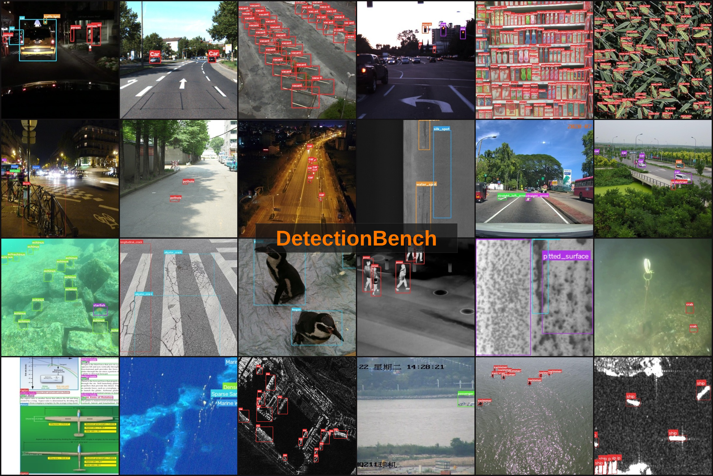

# DetectionBench

<p align="center">
  
</p>

<!-- ROW 1: Core Identity (What this project is) -->
<div style="display: flex; justify-content: center; align-items: center; gap: 8px; flex-wrap: wrap; margin-bottom: 24px;">
  <!-- Project Identity -->
  

  <!-- Tech Stack & Quality -->
  <a href="https://www.python.org/downloads/">
    
  </a>
  <a href="https://pytorch.org/">
    
  </a>
  <a href="https://github.com/dronefreak/DetectionBench/actions/workflows/ci.yml">
    
  </a>
  <a href="https://github.com/astral-sh/ruff">
    
  </a>

  <!-- Metadata -->
  
  
</div>

> DetectionBench exists to make benchmark results on real-world and underrepresented object detection datasets as reproducible, comparable, and trustworthy as benchmarks on COCO have become.

## Why DetectionBench?

Modern object detection research is overwhelmingly evaluated on a small number of canonical datasets such as COCO. In practice, computer vision systems are deployed in domains — aerial robotics, maritime search and rescue, agriculture, underwater inspection, autonomous driving, document understanding — where datasets are smaller, more specialized, and benchmark results are hard to compare.

DetectionBench is a Hydra-driven framework for preparing those datasets, training models, evaluating performance, and benchmarking modern object detectors under standardized conditions: common dataset adapters, reproducible training recipes, a fixed evaluation protocol per model family, and unified hardware profiling, so detectors can be compared fairly across application domains.

## Supported Models

DetectionBench wraps two model families behind one CLI, with shared dataset splits, configs, and entrypoints:

| Family | Backend | Example checkpoints | Entrypoints |
| --- | --- | --- | --- |
| **YOLO** | Ultralytics | `yolov8n/s/m`, `yolov9c/e`, `yolo11n/s/m`, `yolo26n/s/m`, ... | `detectionbench-train`, `detectionbench-evaluate`, `detectionbench-infer` |
| **RT-DETR** | Ultralytics | `rtdetr-l`, `rtdetr-x` | `detectionbench-train`, `detectionbench-evaluate`, `detectionbench-infer` |
| **RF-DETR** | Roboflow `rfdetr` | `rfdetr-nano`, `rfdetr-small`, `rfdetr-medium`, `rfdetr-large` | `detectionbench-train`, `detectionbench-evaluate`, `detectionbench-infer` |

Any Ultralytics-registered YOLO or RT-DETR checkpoint name works out of the box — the YOLO family isn't a fixed enum, `YOLOTrainer` passes the name straight through to Ultralytics. `detectionbench-train` and `detectionbench-evaluate` are each one command for every family: both inspect `model.name=` / `--model` and dispatch to the Ultralytics or RF-DETR path automatically, so a new checkpoint name (or RF-DETR size) never needs a new entrypoint. Every model, regardless of family, also gets hardware profiling (latency, FPS, VRAM, parameters, FLOPs) via `detectionbench-benchmark` and per-class metrics via `detectionbench-evaluate`.

> **Comparing across families.** Recipes are per dataset *and* per family (`configs/<dataset>_yolo.yaml` vs `configs/<dataset>_rfdetr.yaml` differ in resolution, batch size, LR and augmentation). Metrics also come from each family's own evaluator: Ultralytics' validator for YOLO / RT-DETR (default `conf=0.001`, `iou=0.7`) and `supervision`'s `MeanAveragePrecision` for RF-DETR (all queries, `threshold=0.0`). Both are COCO-style mAP@0.5:0.95 on the same split, but small differences in interpolation and matching mean cross-family gaps of a fraction of a point should not be over-read. Precision/recall are reported at each evaluator's best-F1 confidence.

## Supported Datasets

| Dataset | Primary Task | Domain | Classes | Images | License | Source |
| :--- | :--- | :--- | :--- | :--- | :--- | :--- |
| **DocLayNet** | Object Detection / Layout Analysis | Document | 11 | 80,863 | CDLA-Permissive-1.0 | [Hugging Face](https://huggingface.co/datasets/docling-project/DocLayNet-v1.2) |
| **ExDark** | Object Detection | Low-light Robustness | 12 | 7,344 | BSD-3-Clause [^1] | [Hugging Face](https://huggingface.co/datasets/dronefreak/ExDark) |
| **GWHD 2021** | Object Detection | Agriculture (Wheat Heads) | 1 | 6,515 | CC BY 4.0 | [Hugging Face](https://huggingface.co/datasets/dronefreak/GWHD) |
| **SeaDronesSee** | Object Detection / Tracking | Maritime UAV / Search & Rescue | 5 | 10,477 [^2] | CC0-1.0 | [Hugging Face](https://huggingface.co/datasets/dronefreak/SeaDronesSee) |
| **Brackish Underwater** | Object Detection | Marine Animal Detection | 6 | 14,674 | CC BY 4.0 | [Hugging Face](https://huggingface.co/datasets/dronefreak/Brackish) |
| **LISA Traffic Lights** | Object Detection | Autonomous Driving | 7 | 43,017 | CC BY-NC-SA 4.0 | [Hugging Face](https://huggingface.co/datasets/dronefreak/LISA-Traffic-Lights) |
| **VisDrone-DET** | Object Detection | Aerial / UAV Surveillance | 11 | 8,629 [^3] | CC BY-NC-SA 3.0 | [Hugging Face](https://huggingface.co/datasets/Voxel51/VisDrone2019-DET) |
| **GC10-DET** | Object Detection | Industrial / Metallic Surface Defect | 10 | 2,300 [^4] | CC BY 4.0 | [GitHub](https://github.com/lvxiaoming2019/GC10-DET-Metallic-Surface-Defect-Datasets) |
| **RDD2022** | Object Detection | Road Infrastructure / Pavement Damage | 4 | 38,385 [^5] | CC BY-SA 4.0 | [GitHub](https://github.com/sekilab/RoadDamageDetector) |
| **BDD100K 2018** | Object Detection | Autonomous Driving | 10 | 100,000 [^16] | BDD100K Data License (non-commercial redistribution permitted) [^16] | [Hugging Face](https://huggingface.co/datasets/dronefreak/BDD100K) |
| **HRP4K** | Object Detection | Road Infrastructure / Pothole Detection | 1 | 4,086 [^17] | CC BY 4.0 | [Hugging Face](https://huggingface.co/datasets/dronefreak/HRP4K) |
| **PKLot** | Object Detection | Smart Parking / Occupancy Detection | 2 | 12,416 [^18] | CC BY 4.0 | [Hugging Face](https://huggingface.co/datasets/dronefreak/PKLot) |
| **KITTI** | Object Detection | Autonomous Driving | 8 | 7,481 [^19] | CC BY-NC-SA 3.0 | [Hugging Face](https://huggingface.co/datasets/dronefreak/KITTI) |
| **CeyMo** | Object Detection | Autonomous Driving / Road Marking Detection | 11 | 2,887 [^20] | MIT | [GitHub](https://github.com/oshadajay/CeyMo) |
| **UAVDT** | Object Detection / Tracking | Aerial / UAV Vehicle Surveillance | 3 | 77,819 [^6] | Research-use only [^6] | [Official site](https://sites.google.com/view/grli-uavdt) |
| **DUO** | Object Detection | Underwater Robot Picking | 4 | 7,782 [^7] | Unclear [^7] | [GitHub](https://github.com/chongweiliu/DUO) |
| **HRSID** | Object Detection / Instance Segmentation | Maritime SAR / Ship Detection | 1 | 5,604 [^8] | Unknown | [Hugging Face](https://huggingface.co/datasets/dronefreak/HRSID) |
| **SeaShips** | Object Detection | Maritime Surface / Ship Detection | 6 | 7,000 [^9] | Unknown | [Hugging Face](https://huggingface.co/datasets/dronefreak/SeaShips) |
| **PubLayNet** | Object Detection / Layout Analysis | Document | 5 | 346,948 [^10] | CDLA-Permissive-1.0 (annotations) [^10] | [GitHub](https://github.com/ibm-aur-nlp/PubLayNet) |
| **LLVIP** | Object Detection | Autonomous Driving / Low-light Infrared | 1 | 15,488 [^11] | Non-commercial [^11] | [GitHub](https://github.com/bupt-ai-cz/LLVIP) |
| **SKU-110K** | Object Detection | Retail / Dense Detection | 1 | 11,743 [^12] | Non-commercial (exclusive use) [^12] | [GitHub](https://github.com/eg4000/SKU110K_CVPR19) |
| **MARIDA** | Object Detection | Remote Sensing / Marine Debris | 15 | 1,381 [^13] | CC BY 4.0 | [Hugging Face](https://huggingface.co/datasets/dronefreak/MARIDA) |
| **NEU-DET** | Object Detection | Industrial / Steel Surface Defect | 6 | 1,800 [^14] | Unclear [^14] | [Official site](http://faculty.neu.edu.cn/songkc/en/zdylm/263265/list/index.htm) |
| **Animals Detection** | Object Detection | Wildlife / Biodiversity | 80 | 27,652 [^21] | Open Images CC BY (images 2.0 / annotations 4.0) [^21] | [Kaggle](https://www.kaggle.com/datasets/antoreepjana/animals-detection-images-dataset) |
| **SSDD** | Object Detection | Maritime SAR / Ship Detection | 1 | 1,160 [^15] | Apache 2.0 [^15] | [Hugging Face](https://huggingface.co/datasets/dronefreak/SSDD) |

[^1]: BSD-3-Clause license text, but the authors separately request non-commercial use.
[^2]: No public test-set labels; train + validation only, evaluated on validation.
[^3]: Train + val + test-dev (6,471 / 548 / 1,610); test-challenge has no public ground truth.
[^4]: No official split; seeded 80/10/10.
[^5]: Uses the `RDD_SPLIT` export's train/val/test split. The 5th source class (D50, "other") is dropped to the 4-class CRDDC2022 taxonomy.
[^6]: Research use only, no redistribution grant: **no** Hugging Face mirror. Official test split; sequence-aware seeded validation split carved from train.
[^7]: No stated license; re-annotates URPC contest data: **no** Hugging Face mirror. Seeded 15% validation slice carved from train.
[^8]: Mirrored as `license: unknown`: the repo's GPL-3.0 file doesn't clearly cover the data, and part of the imagery is TerraSAR-X/TanDEM-X (DLR, scientific use). Official `test2017`; seeded 15% validation slice from `train2017`.
[^9]: Mirrored as `license: unknown`: no license is stated upstream and the original host is offline. Official train/val/test, used as-is.
[^10]: Train + val (335,703 + 11,245); the unlabeled ICDAR 2021 test set is not converted. Annotations CDLA-Permissive-1.0 (IBM); images follow the PMC Open Access Subset terms. 100 GB+, not mirrored: use a third-party Hugging Face/Kaggle re-upload.
[^11]: Non-commercial use only, no redistribution grant: **no** Hugging Face mirror. Infrared frames only, so half the official 30,976 (visible + infrared) count. Official test split; seeded 15% validation slice from train.
[^12]: Academic, non-commercial use by the recipient only: **no** Hugging Face mirror. Single class (`object`), official split.
[^13]: Natively a weakly-supervised segmentation dataset (Sentinel-2): boxes come from connected components of the masks (8-connectivity, < 4 px dropped), and images are rendered as RGB from bands B04/B03/B02. Official patch-id splits, 15 source classes kept.
[^14]: No license stated, citation requested, no redistribution grant: **no** Hugging Face mirror. No official split; seeded 80/10/10.
[^15]: Explicit Apache-2.0 license, but part of the imagery is TerraSAR-X (same DLR sensor-rights caveat as HRSID). Official train/test; seeded 15% validation slice from train.
[^16]: BDD100K license: redistribution allowed for educational, research and not-for-profit use with notice; commercial use needs UC Berkeley's permission. Original 2018 labels. Official splits used as-is: 70,000 / 10,000 / 20,000.
[^17]: The Zenodo archive ships only 2,286 of the 4,203 training images listed in `train.json`, so the total is below the announced 6,003.
[^18]: No official split; grouped by (camera, capture day), so validation/test measure unseen days on seen cameras, not new camera positions.
[^19]: No public test labels; uses the standard Chen et al. 2015 (3DOP) train/val split (3,712 / 3,769), with all metrics on val.
[^20]: No official validation split; official test kept, seeded validation set carved from train. Not yet trained in DetectionBench.
[^21]: 80-class Open Images subset: images CC BY 2.0, annotations CC BY 4.0 (the Kaggle re-upload mislabels it CC0). Duplicate photos across class folders are merged; seeded 15% validation slice from train. Not yet trained in DetectionBench.

Datasets without a mirror (UAVDT, DUO, LLVIP, SKU-110K, NEU-DET) download from their official links with `detectionbench-download-dataset --dataset <key>`. Per-split image and box counts are in each dataset's statistics report (below); split-construction details are in the adapter docstrings.

Each dataset is a self-contained adapter under `src/detectionbench/datasets/` that converts its raw format into a canonical COCO layout — everything downstream (COCO↔YOLO conversion, training, evaluation, inference, benchmarking) is dataset-agnostic. See `src/detectionbench/datasets/doclaynet.py` for a fully worked adapter.

Every dataset also has a statistics report under [`docs/datasets/<dataset>/`](../docs/datasets/) — class distribution, split sizes, box geometry, and (where meaningful) a per-sequence/location breakdown, computed from real data via `detectionbench-dataset-stats`.

### Dataset formats: YOLO vs. COCO

The dataset repos linked above are published on Hugging Face in **Ultralytics YOLO format only** (`images/` + `labels/` + `data.yaml`) — this is what YOLO and RT-DETR training/evaluation consume, via each dataset config's `dataset_yaml`.

**RF-DETR needs a canonical COCO dataset** (per-split `_annotations.coco.json`), referenced by `dataset_dir`. That layout is **not distributed on Hugging Face** — generate it locally from the downloaded YOLO copy:

```bash
detectionbench-convert-yolo-to-coco \
  --input-dir  /path/to/<dataset>_yolo \
  --output-dir /path/to/<dataset>_coco \
  --dataset-yaml /path/to/<dataset>_yolo/data.yaml
```

then point `dataset_dir` in `configs/dataset/<key>.yaml` at the `--output-dir`. (DocLayNet is the exception: it ships COCO JSONs upstream, so `detectionbench-prepare-coco` produces its `dataset_dir` directly.)

<!-- LEADERBOARD:START -->
## Leaderboards

Best model per dataset from DetectionBench's [v1 model shortlist](../ROADMAP.md) (the same models across every dataset, for a fair comparison). Full per-dataset tables: **[LEADERBOARDS.md](../LEADERBOARDS.md)**. Every trained model also gets its own HF model card with its own complete leaderboard.

| Dataset | Best v1 Model | mAP@50 | mAP@50-95 | HF Model |
| --- | --- | --- | --- | --- |
| BDD100K | YOLO26m | 61.55 | 35.88 | [dronefreak/bdd100k-yolo26m](https://huggingface.co/dronefreak/bdd100k-yolo26m) |
| Brackish Underwater | YOLOv8s | 99.3 | 85.65 | [dronefreak/brackish-yolov8s](https://huggingface.co/dronefreak/brackish-yolov8s) |
| ExDark | RF-DETR Small | 88.98 | 61.67 | [dronefreak/exdark-rfdetr-small](https://huggingface.co/dronefreak/exdark-rfdetr-small) |
| GC10-DET | RF-DETR Small | 76.07 | 42.51 | [dronefreak/gc10det-rfdetr-small](https://huggingface.co/dronefreak/gc10det-rfdetr-small) |
| Global Wheat Head Dataset | YOLO11x | 74.25 | 34.92 | [dronefreak/gwhd-yolo11x](https://huggingface.co/dronefreak/gwhd-yolo11x) |
| HRP4K | RF-DETR Small | 56.04 | 31.54 | [dronefreak/hrp4k-rfdetr-small](https://huggingface.co/dronefreak/hrp4k-rfdetr-small) |
| KITTI | YOLOv8s | 41.99 | 25.2 | [dronefreak/kitti-yolov8s](https://huggingface.co/dronefreak/kitti-yolov8s) |
| LISA Traffic Lights | RF-DETR Medium | 33.01 | 14.12 | [dronefreak/lisa-rfdetr-medium](https://huggingface.co/dronefreak/lisa-rfdetr-medium) |
| PKLot | YOLO11n | 99.42 | 94.99 | [dronefreak/pklot-yolo11n](https://huggingface.co/dronefreak/pklot-yolo11n) |
| RDD2022 Road Damage | RF-DETR Medium | 65.08 | 36.02 | [dronefreak/rdd2022-rfdetr-medium](https://huggingface.co/dronefreak/rdd2022-rfdetr-medium) |
| SeaDronesSee | RF-DETR Medium | 83.47 | 47.49 | [dronefreak/seadronessee-rfdetr-medium](https://huggingface.co/dronefreak/seadronessee-rfdetr-medium) |
| UAVDT | YOLO26m | 33.43 | 19.56 | [dronefreak/uavdt-yolo26m](https://huggingface.co/dronefreak/uavdt-yolo26m) |
| VisDrone-DET | YOLO26m | 49.11 | 29.24 | [dronefreak/visdrone-yolo26m](https://huggingface.co/dronefreak/visdrone-yolo26m) |
<!-- LEADERBOARD:END -->

## Installation

```bash
git clone https://github.com/dronefreak/DetectionBench.git && cd DetectionBench
python -m venv .venv && source .venv/bin/activate
pip install -e ".[dev]"          # core + dev tooling
pip install -e ".[rfdetr]"       # + RF-DETR training/eval
pip install -e ".[coco]"         # + pycocotools
pip install -e ".[benchmark]"    # + hardware-profiling extras (psutil, thop, fvcore, torchinfo, nvidia-ml-py)
```

Install from a clone in editable mode (`-e`): the CLIs read their Hydra configs from the repo's `configs/` directory, so a plain `pip install` from a wheel will not find them.

**Point the dataset configs at your data first.** Each `configs/dataset/<key>.yaml` holds two absolute paths from the author's machine — `dataset_yaml` (Ultralytics `data.yaml`, used by YOLO / RT-DETR) and `dataset_dir` (canonical COCO root, used by RF-DETR). Edit them, or override per run with `dataset.dataset_yaml=...` / `dataset.dataset_dir=...` (training) or `--dataset-yaml` / `--dataset-dir` (evaluation).

## Usage

```bash
# 1. Convert a raw dataset download into the canonical COCO layout
detectionbench-prepare-coco --dataset doclaynet --raw-dir /path/to/DocLayNet_core --output-dir /path/to/doclaynet_coco

# 2. Bridge into Ultralytics YOLO format (for YOLO/RT-DETR training)
detectionbench-convert-coco-to-yolo --input-dir /path/to/doclaynet_coco --output-dir /path/to/doclaynet_yolo

# 3. Train + evaluate (Hydra config group `dataset=<key>` selects the dataset;
#    one entrypoint for every model family, dispatched by `model.name=`)
detectionbench-train dataset=doclaynet model.name=yolov8n
detectionbench-train dataset=doclaynet model.name=rfdetr-nano

# 4. Evaluate / infer / benchmark a checkpoint directly (--dataset-yaml is
#    optional -- it auto-resolves from configs/dataset/<key>.yaml if omitted;
#    the same command works unchanged for model=rfdetr-nano)
detectionbench-evaluate --checkpoint experiments/doclaynet/yolov8n/yolov8n/weights/best.pt --model yolov8n --dataset doclaynet
detectionbench-infer --checkpoint experiments/doclaynet/yolov8n/yolov8n/weights/best.pt --model yolov8n --dataset doclaynet --input /path/to/images
detectionbench-benchmark --model yolov8n --checkpoint experiments/doclaynet/yolov8n/yolov8n/weights/best.pt

# Or let a training config supply dataset, checkpoint and output paths:
detectionbench-evaluate --config-name visdrone_yolo --model yolov8n
```

## License

Code is licensed under Apache-2.0 (see `LICENSE`). Each benchmarked dataset
retains its own original license — see the corresponding adapter's docstring
under `src/detectionbench/datasets/`, `CITATION.cff`, and, where mirrored,
its Hugging Face dataset card.
