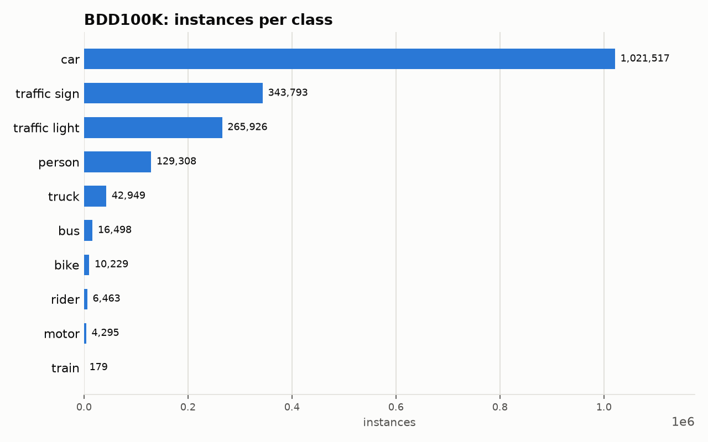

# BDD100K: Dataset Statistics

## About

BDD100K is a large-scale, diverse driving-video dataset; this adapter covers its 100K-image object-detection task: all 100,000 1280x720 dashcam images (70,000 train + 10,000 val + 20,000 test, all three officially released with real labels) annotated for 10 classes spanning vulnerable road users (person, rider), vehicles (car, truck, bus, train, motor, bike), and traffic control (traffic light, traffic sign), captured across diverse weather, time-of-day, and scene conditions in the US. It's used to benchmark multi-class driving-scene detection under real-world distribution shift.

Computed from the canonical COCO layout produced by `detectionbench-prepare-coco --dataset bdd100k`. See the adapter and Hydra config for how these splits are built.

## Split Summary

| Split | Images | Instances | Instances / Image |
| :--- | ---: | ---: | ---: |
| train | 70,000 | 1,288,010 | 18.40 |
| valid | 10,000 | 185,526 | 18.55 |
| test | 20,000 | 367,621 | 18.38 |
| **Total** | **100,000** | **1,841,157** | **18.41** |

## Class Distribution



| Class | Instances | Share |
| :--- | ---: | ---: |
| car | 1,021,517 | 55.5% |
| traffic sign | 343,793 | 18.7% |
| traffic light | 265,926 | 14.4% |
| person | 129,308 | 7.0% |
| truck | 42,949 | 2.3% |
| bus | 16,498 | 0.9% |
| bike | 10,229 | 0.6% |
| rider | 6,463 | 0.4% |
| motor | 4,295 | 0.2% |
| train | 179 | 0.0% |

## Bounding Box Geometry

- Median box area: **0.09%** of image area (mean 0.73%)
- Instances per image: mean **18.41**, median **17**, max **91**

## References

**Citation:**

```bibtex
@inproceedings{yu2020bdd100k,
  title={BDD100K: A Diverse Driving Dataset for Heterogeneous Multitask Learning},
  author={Yu, Fisher and Chen, Haofeng and Wang, Xin and Xian, Wenqi and Chen, Yingying and Liu, Fangchen and Madhavan, Vashisht and Darrell, Trevor},
  booktitle={Proceedings of the IEEE/CVF Conference on Computer Vision and Pattern Recognition},
  pages={2633--2642},
  year={2020}
}
```

- Project website: <https://www.bdd100k.com/>

---

Regenerate this report with:

```bash
python -m detectionbench.scripts.dataset_stats --coco-dir <bdd100k_coco> --dataset bdd100k --output-dir docs/datasets/bdd100k
```
